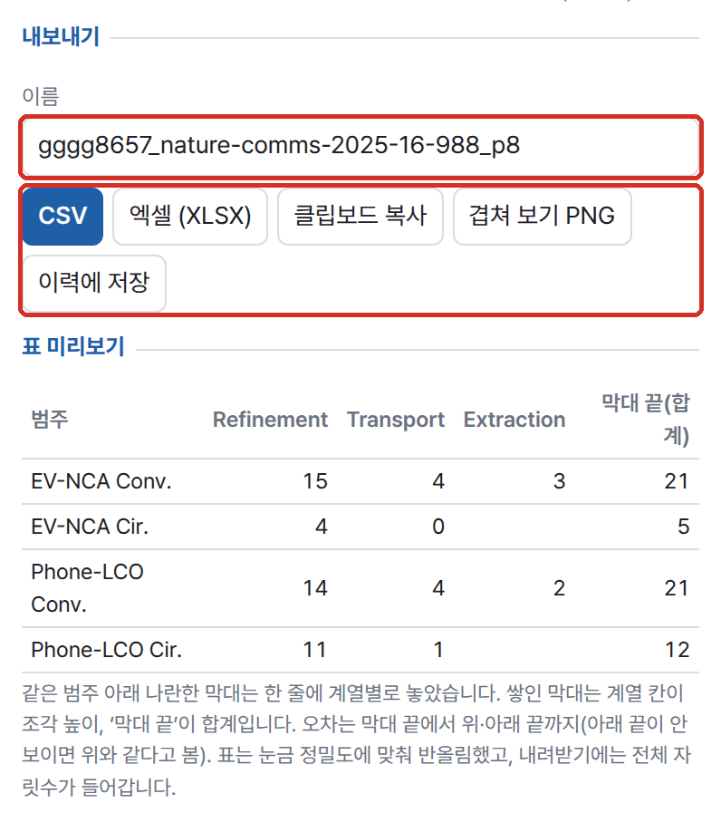
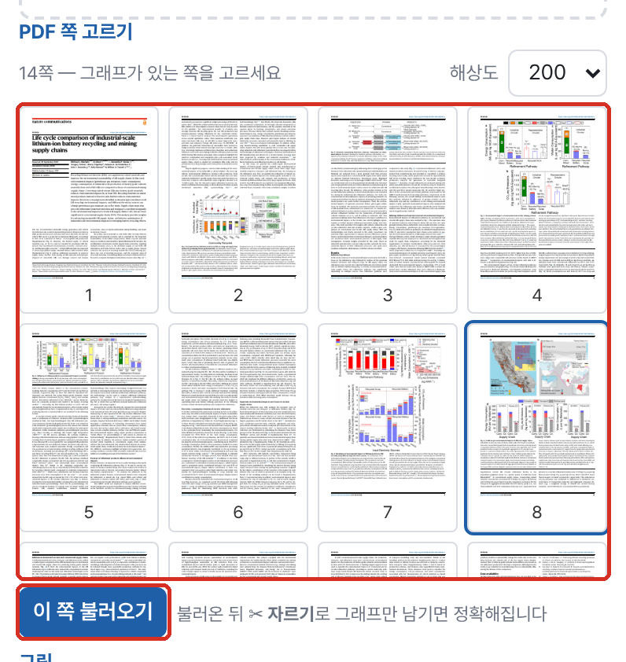
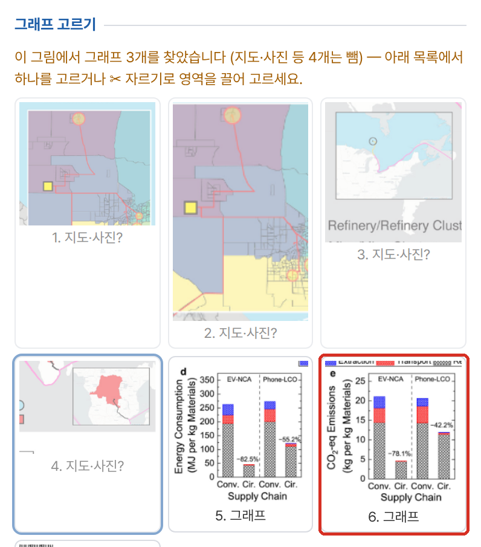
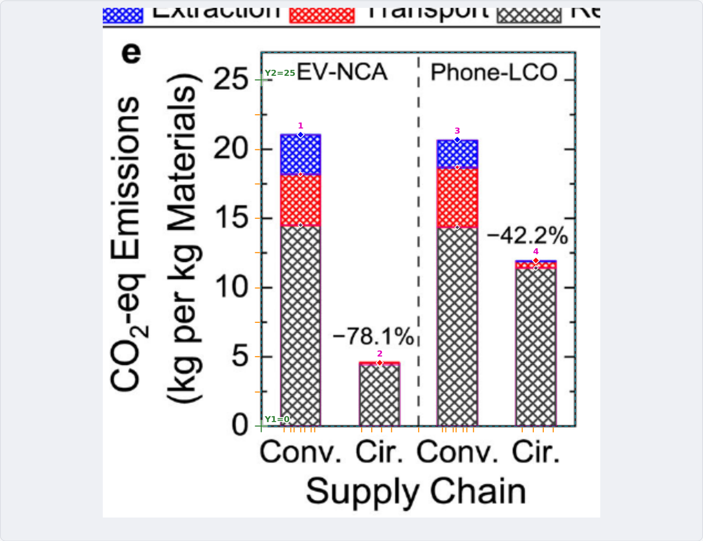

# digitizer-local — 그래프 디지타이저 (그림 → 데이터)

논문·보고서의 그래프 그림(스크린샷, PDF 쪽)에서 곡선·점·막대의 값을 숫자로 뽑아 CSV나 엑셀로 내보내는 로컬 웹 도구입니다. 포트 `8783`.

> ⚠️ 연구·내부 시험용 프로토타입입니다(배포·상업 서비스용 아님). 제3자 구성요소의 라이선스는 THIRD_PARTY_NOTICES.md 를 확인하세요.



## 무엇을 하나

- 축선·눈금·눈금 글자를 픽셀 처리로 찾고, 축 보정(최소제곱)으로 좌표를 계산합니다. **좌표는 AI가 어림하지 않습니다.**
- 로컬 VLM(포털 기본: Ollama `gemma4:31b`)은 눈금 숫자, 축 이름, 범례 이름과 색만 읽습니다. 없으면 수동 보정으로 씁니다.
- 곡선·점(표식)·막대(쌓인 조각·오차 막대)를 색 마스크로 뽑고, CSV(UTF-8 BOM)·XLSX·클립보드·겹쳐 보기 PNG로 내보냅니다.
- **지원 범위는 2D 직교좌표 그래프(선·산점·막대)입니다.** 3D·극좌표·파이/도넛·히트맵·등고선은 자동 추출을 멈추고 "지원하지 않는 형식(○○)입니다" 안내와 `code: "unsupported_chart"` 를 돌려줍니다(아래 **지원하지 않는 그림**). 직교 축이 있는 그림이면 '그래도 자동 보정'이나 수동 보정으로 진행할 수 있습니다.
- 축선이 없는 차트(ggplot·seaborn 회색 바탕, OWID 같은 웹 차트, 엑셀형)는 바탕 사각형·격자선 끝·눈금 글자 배치로 그림 영역을 잡고, "90 years"·"$5,000"·"40%"·"1.2k"·"1E-10"·"×10³" 처럼 단위가 붙은 눈금도 숫자로 읽습니다.
- 0.2~5° 기울어진 스캔은 축선·격자선 각도를 재서 먼저 바로 세우고(deskew), 바로 세운 각도를 결과(`deskew.angle`)에 남깁니다.
- CDN이나 외부 통신을 쓰지 않으며, 폐쇄망에서도 동작합니다. 필요한 것은 Python + numpy + Pillow이고, openpyxl은 엑셀 내보내기용입니다. PDF를 읽으려면 pdftoppm이나 PyMuPDF가 있어야 합니다.

## 사용 방법







1. **1 그림** 탭의 업로드 영역에 그림(PNG·JPG)이나 PDF를 끌어 놓거나 클릭해서 고릅니다. Ctrl+V 로 스크린샷을 붙여 넣어도 됩니다. 그림은 오른쪽 캔버스에 뜹니다. PDF면 쪽을 고르고 **이 쪽 불러오기**를 누릅니다. 그래프가 여러 개인 쪽이면 **그래프 고르기** 목록에서 하나를 고르거나 **✂ 자르기**로 영역을 끕니다.
2. **2 축 보정** 탭에서 **✨ AI 자동 보정**을 누르거나, 축 위의 두 점씩(X1·X2·Y1·Y2)을 클릭하고 값을 넣습니다. 잔차(px)가 1px 안팎이면 정상입니다.
3. **3 데이터** 탭에서 계열 색을 고르고(스포이트·그림에서 찾은 색 칩·AI 제안 계열) 방식(곡선·점·수동·막대)을 정한 뒤 **▶ 추출**을 누릅니다. AI가 켜져 있으면 그림을 올리자마자 2·3단계가 자동으로 진행됩니다.
4. **4 결과** 탭에서 재구성 그래프와 원본 위 추출점을 비교하고 **이름**을 정한 뒤 **CSV / 엑셀(XLSX) / 클립보드 복사 / 겹쳐 보기 PNG**로 내보냅니다. **이력에 저장**하면 다시 불러올 수 있습니다.

## 예시

포털 경유로 실제 실행한 결과입니다(2026-10-12, 위 화면).

- **입력**: 공개 논문 PDF `nature-comms-2025-16-988.pdf` (Nature Commun. 16, 988) 8쪽 → 찾아낸 그래프 7개 중 6번 Fig. 6e (쌓인 막대)
- **보정**: AI 자동 보정 — 값축 y 선형 0…25, 막대 4개·조각 자동 검출
- **출력**: 범주 4줄 × 계열 3개(Refinement·Transport·Extraction) + 막대 끝(합계), 이름 `gggg8657_nature-comms-2025-16-988_p8` 로 CSV·XLSX 내보내기

| 범주 | Refinement | Transport | Extraction | 합계 |
|---|---|---|---|---|
| EV-NCA Conv. | 15 | 4 | 3 | 21 |
| EV-NCA Cir. | 4 | 0 | | 5 |
| Phone-LCO Conv. | 14 | 4 | 2 | 21 |
| Phone-LCO Cir. | 11 | 1 | | 12 |

## 설치·실행

```bash
bash setup.sh                 # Python → numpy·Pillow(없으면 venv) → VLM 탐색(선택) → selftest → http://localhost:8783
bash setup.sh stop
python3 app.py                # 수동 실행 (0.0.0.0:8783)
python3 app.py --cli 그림.png 보정.json 계열.json > out.csv   # 서버 없이 추출
python3 selftest.py           # LLM 없이 합성 그래프로 정확도 검증 (WORKSPACE 를 임시 폴더로 바꿔 돌고 지움)
```

| 환경변수 | 기본 | 설명 |
|---|---|---|
| `PORT` | `8783` | |
| `WORKSPACE` | `./_workspace` | 올린 그림 `images/`, PDF `pdf/`, 작업(보정·점) `projects/*.json` |
| `BIND` | (모든 인터페이스) | 포털이 `127.0.0.1` 을 줌 — 포털을 거쳐서만 접근 |

포털 접속자 기준으로 올린 그림·PDF·이력은 사용자별로 따로 저장합니다(`WORKSPACE/u/<사용자>/`, 포털이 넘기는 `X-Agent-User` 헤더). 서버 주인(owner)·단독 실행은 예전처럼 `WORKSPACE` 바로 아래를 쓰므로 예전 기록이 그대로 보입니다. 포털이 `BIND=127.0.0.1` 을 주면 포털을 거쳐서만 열립니다.
| `LLM_API` / `LLM_BASE_URL` / `VISION_MODEL`(또는 `LLM_MODEL`) | `ollama` / `http://localhost:11434` / `gemma3:27b` | AI 자동 보정에만 씁니다. 이미지 입력을 받는 모델이어야 하고, 없으면 그 버튼만 꺼집니다. 포털로 띄우면 로컬 Ollama(`:11436`)의 `gemma4:31b` 가 넘어옵니다 |

## 흐름

1. **그림**: 업로드, 끌어 놓기, Ctrl+V로 넣습니다. PDF는 쪽 썸네일에서 고른 뒤 150~400 dpi로 그림으로 바꿉니다(pdftoppm).
   - **여러 그래프가 있는 쪽**(`bars.find_panels`): 왼쪽 세로축과 아래 가로축이 만나는 모서리를 가진 축 상자를 모두 찾습니다(위아래로 축을 같이 쓰는 그래프도 나눔). 안이 빽빽한 상자(지도·사진)와 왼쪽에 눈금 글자가 없는 상자는 표시만 하고 뺍니다. 그래프가 둘 이상이거나 하나가 쪽의 일부일 때 자동 보정은 `need_panel`과 목록을 돌려주고, 화면은 **그래프 고르기** 썸네일을 보여 줍니다. 고르면 눈금 글자·축 이름까지 넣어(옆 그래프·빈 띠에서 멈춤) 새 그림으로 자르고 원본·위치를 `images/<id>.json`에 적습니다(`/api/crop`). **✂ 자르기**(영역 끌기)도 같은 경로입니다.
2. **축 보정**
   - 검출(결정론): 가장 아래의 긴 가로선을 x축, 가장 왼쪽의 긴 세로선을 y축으로 잡습니다. 세로축선이 없는 엑셀형 그래프는 가로 격자선의 왼쪽 끝을 y축으로 씁니다. 눈금은 바깥 눈금 → 안쪽 눈금 → 격자선 순서로 찾고, 굵기에 맞춰 작은 눈금과 큰 눈금을 가릅니다. 눈금 글자는 축 아래의 첫 글줄과 축 왼쪽의 첫 글기둥에서 덩어리 단위로 잡습니다.
   - VLM: (1) 그래프 전체와 확대한 눈금 글자 띠를 보고 눈금 값 목록·축 이름·로그 여부·범례를 읽고, (2) 글자 덩어리마다 번호를 붙인 그림을 보고 덩어리별 값을 1:1로 읽습니다.
   - 짝짓기: 값을 글자 위치에 맞추고, 가까운 큰 눈금이나 축 끝에 붙인 뒤 최소제곱 직선을 구합니다(로그축은 log10 공간). 튀는 짝(모서리에서 겹친 글자, 잘못 읽은 값)은 최대 1/3까지 빼고 다시 맞춥니다. 개수가 달라 한 칸 어긋났을 가능성이 있으면 경고합니다.
   - 선형·로그 판단: 짝이 3개 이상이면 잔차로 정합니다. 짝이 둘뿐이면 작은 눈금 간격 모양(2…9로 점점 좁아지는지)을 보고, 그래도 모르면 VLM 판단을 따릅니다.
   - 수동: 축 위의 두 점씩(X1·X2·Y1·Y2)을 클릭하고 값을 넣습니다. 돋보기로 픽셀 아래 정밀도까지 찍을 수 있습니다. AI 없이 눈금 값만 입력해서 검출한 위치에 맞출 수도 있습니다.
   - **축선이 없는 그래프**(`frame.py`): 진한 축선이 하나도 없거나 바닥선만 납작하게 잡히면 (1) 종이색과 다른 바탕 사각형(ggplot 회색, seaborn 푸른 회색, fivethirtyeight 연회색) = 그림 영역, 그 안의 바탕보다 밝거나 어두운 긴 줄 = 격자선(눈금 위치), (2) 연한 무채색 긴 줄(파선·점선은 틈을 이음, 눈금 글자 옆 안티앨리어싱은 뺌)의 왼쪽·오른쪽 끝 = 그림 영역 좌우, 세로 격자선 끝(없으면 맨 위·아래 가로선) = 위아래 순서로 잡습니다. 이때 눈금은 격자선이고, 축선이 없으니 축선에 붙은 눈금은 찾지 않습니다. 첫·끝 x 글자를 그림 안쪽으로 당겨 찍은 웹 차트는 양 끝 짝을 함께 빼고 맞춥니다. 맨 위 격자선 위로 조금 넘친 선도 추출합니다.
   - **단위 붙은 눈금**: `num()` 이 앞의 부호·통화 기호(`$ € £ ¥ ₩`, `US$`)와 뒤의 숫자 없는 단위(`years`, `%`, `t`, `TWh`, `°C` 등)를 떼고, `k·M·B·bn·만·억` 배수는 곱합니다. `Q1`·`Farmer A` 같은 범주 글자는 숫자로 보지 않습니다. 연도처럼 한 자릿수(10배)도 안 되는 눈금은 로그축 후보로 보지 않습니다(VLM 이 로그라고 하면 예외).
   - **기울기 보정(deskew, `deskew.py`)**: 무채색 어두운 픽셀을 가로선은 y − x·tanθ, 세로선은 x + y·tanθ 로 펴서 줄 높이 히스토그램이 가장 뾰족한 θ(±5°, 0.01° 단위)를 찾습니다. 0.2° 이상이고 펴진 긴 선(그림 폭·높이의 40% 넘게)이 생겨 뾰족함이 1.5배 넘게 커질 때만 돌립니다. 바로 세운 그림은 새 그림으로 저장(`images/<id>.json` 에 `deskew` 각도)하고 이후 좌표·자르기는 그 그림 기준이며, 응답 `deskew = {angle: 내용이 기운 각도(반시계 +), image, from}` 과 경고·메시지로 알립니다. 화면은 바로 세운 그림으로 바꿔 보여 줍니다. 0.2° 미만은 돌리지 않지만, 보정이 X1→X2·Y1→Y2 방향 사영이라 그 정도 기울기는 보정만으로도 맞습니다.
3. **추출** (계열마다 색 ± 허용오차)
   - 곡선: 열마다 마스크 덩어리의 중심을 구합니다. 한 열에 덩어리가 여럿이면 앞 점의 추세에 가까운 것을 고릅니다. 큰 점프로 갈라진 짧은 조각(범례 견본, 글자)은 버립니다. 출력은 점 수 N(로그축이면 로그 간격), x 간격, 열마다 전부 중에서 고르며, 큰 틈은 보간하지 않습니다.
   - 점: 연결 성분의 중심을 구합니다. 다른 선에 갈린 빈 표식 조각은 합칩니다. 표식이 같은 색 선으로 이어진 경우는 선이 없어질 때까지 침식합니다. 다른 선과 붙은 표식은 깨끗한 표식들로 만든 틀과의 상호상관으로 찾습니다. 글자와 범례 견본(오른쪽에 글자가 붙은 표식)은 뺍니다.
   - 공통: 축선, 테두리에 붙은 안쪽 눈금, 같은 색 격자선과 직선, 테두리 있는 범례 상자, 사용자가 지정한 제외 영역은 뺍니다.
   - **겹친 선·점선** (2026-10-19): 곡선 추적은 끊긴 틈(다른 선에 가림·파선) 뒤에 예측에서 멀리 떨어진 조각(다른 선의 번짐·글자)이 나오면 몇 열(최대 8열) 기다렸다가 따라가고, 바로 옆 열과 맞닿은 덩어리(계단의 세로 부분)는 그대로 따라갑니다 — 교차점에서 계열이 바뀌지 않습니다. 색이 가까운 다른 계열이 있으면 허용오차를 줄여(가까운 색 거리의 45%, 25~60) 두 선이 한 마스크에 섞이지 않게 합니다. 점선·파선은 열 틈이 잘고 고르며 한 줄로 매끄럽게 이어지면 곡선으로 보고 조각 사이를 잇습니다. 표식은 거리변환으로 선보다 뚜렷이 두꺼운 것만 표식으로 봅니다(선의 계단·파선 조각을 표식으로 오인하지 않음).
   - **같은 색 오차막대·선과 붙은 표식**: AI 가 표식(산점·markers)이라는데 선으로 뽑히면, 구멍 메움(속 빈 표식 → 원판) → 열림으로 가는 줄기·캡·선을 지우고 표식 중심만 씁니다. 같은 색의 선 계열(표식 없음)과 표식 계열(흑백 논문: 모형 곡선 + 실험 점)은 표식을 떼어 낸 나머지를 곡선으로 뽑고, 테두리 없는 범례의 견본·글자는 뺍니다.
   - 수동: 점을 추가하고 끌어서 옮기고 지울 수 있습니다(Shift+클릭이나 우클릭으로 삭제).
4. **막대그래프** (`bars.py`, 종류 '자동'이면 VLM 이 bar/hbar 라 하거나 x 숫자 눈금이 없고 막대가 보일 때 전환, 이유를 메시지로 알림)
   - 보정: **값축만** 기존 방식(글자 덩어리 ↔ VLM 값 짝짓기, 최소제곱)으로 맞춥니다. 범주축은 픽셀 위치 그대로 씁니다. 가로 막대는 그림을 90° 돌려 같은 코드로 잽니다.
   - 막대: 축선 위 바닥 띠에 닿은 연결 성분 = 막대. 채운 막대는 굵은 덩어리, 빈 막대(흰 채움+색 테두리)는 가는 양 벽이 위 가로선으로 이어진 것, 빗금만 있는 바닥은 사이 열에도 무늬가 차 있으면 한 막대로 봅니다. 맞붙은 묶음 막대는 바닥 색이 깨끗하게 바뀌는 곳에서 나눕니다. 점선 구분선·퍼센트 주석·막대 위 글자는 바닥에 닿지 않거나 너무 가늘어 빠집니다.
   - 꼭대기: 위 테두리선이 있으면 선 굵기의 가운데(어둡기 가중), 테두리 없는 채움이면 안티앨리어싱 덮임 비율로 픽셀 아래까지 잽니다.
   - 쌓인 조각: 테두리 안쪽 양옆 띠(가운데의 오차 줄기·글자 상자는 피함)에서 행마다 잉크 비율·잉크 색을 구하고, 무늬 주기보다 넓은 창으로 위·아래를 비교해 바뀌는 곳(또는 가로 테두리선)을 경계로 잡습니다. 같은 채움 사이에 낀 글자 상자, 무늬 위상 차로 생긴 가짜 경계, 1~2px 테두리 조각은 합칩니다.
   - 채움 모양 = 주 색(잉크 픽셀 중 진한 절반 평균) + 잉크 비율(꽉 참·빗금·빈 칸) + 빈 칸이면 테두리 색. 이것으로 조각을 계열로 묶고, 범례 견본(테두리 있는 작은 사각형 + 오른쪽 글자, 범례 틀은 긴 직선을 끊고 찾음)과 짝짓습니다. 자른 그림이면 원본의 위쪽·옆에서도 범례를 찾습니다.
   - 오차 막대: 막대 가운데 위로 뻗은 가는 줄기와 끝 캡 → 위 끝, 빈(또는 꽉 찬) 맨 위 조각 안에서 가운데만 다른 색인 줄기 → 아래 끝(안 보이면 위와 대칭으로 봄).
   - 이름: VLM 이 (1) 막대마다 번호표를 붙인 그림에서 범주 이름·그룹 머리글·막대 이름표(Py* 등)를, (2) 범례 글자 조각을 하나씩 읽습니다. 같은 범주 이름이 반복되면 이름표 → 그룹 → 번호 순으로 구분합니다.
   - 결과: 막대·조각 끝은 픽셀로 들고 다니고 보정으로 값을 냅니다(화면에서 ◆·＋를 끌어 고침). 표 = 범주 × 계열: 같은 범주 이름 아래 나란한 막대(묶음 막대)는 한 줄에 계열별 칸으로, 쌓인 막대가 있으면 '막대 끝(합계)', 오차 막대가 있는 계열마다 '오차 +/−'. 화면 표는 눈금 정밀도(2픽셀)에 맞춰 반올림하고 CSV·XLSX(데이터·막대 조각·보정 시트)는 전체 자릿수.
5. **자동 추출 (선·점)**: AI 자동 보정이 끝나면 제안 계열(범례 이름+색, 범례가 없으면 그림에서 찾은 색)을 모두 바로 뽑아 결과 탭에 표를 채웁니다(`D.auto_series`). 방식은 마스크 모양으로 고릅니다 — 선이 이어지면 선, 선 위에 표식이 있으면 **표식 중심(실제 데이터 점)**, 띄엄띄엄이면 점. 다른 선·범례에 가린 등간격 표식은 이웃 사이로 채우고 경고합니다. 같은 색 계열이 여럿(흑백 그림)이면 표식 모양(○□△◇, 속 빈/찬)으로 가르고 VLM 이 읽은 표식 모양·범례 견본 순서로 이름을 붙입니다(`D.marker_groups`). 오른쪽 y축이 있으면 그 눈금을 따로 맞추고, 범례에서 오른쪽 축이라고 읽은 계열은 오른쪽 눈금으로 값을 냅니다(데이터 탭에서 계열별로 바꿀 수 있음). 그림을 올리면(AI 가 있을 때) 바로 이 과정까지 갑니다. 한 쪽짜리 PDF 는 쪽 고르기를 건너뜁니다.
6. **결과**: 원본 위에 추출점을 겹쳐 보고, 마스크와 재구성 그래프로 검증합니다. CSV(UTF-8 BOM)와 XLSX(데이터·계열별·보정 시트), 클립보드(TSV), 겹쳐 보기 PNG로 내보낼 수 있고, 작업 이력을 남깁니다. 점은 늘 픽셀 좌표로 저장되므로 보정을 고치면 값도 따라 바뀝니다.

## 정확도 (selftest 실측, 2026-10-06)

참값(함수와 정확한 픽셀 변환)을 아는 합성 그래프를 그린 뒤 **자동 보정 → 추출** 전 과정을 거친 오차입니다. 자동 보정에 필요한 눈금 값은 가짜 VLM이 정답 목록으로 줬습니다.
**보정%**는 자동 보정이 그림 영역 모서리에서 틀린 정도이고, **rms/max%**는 추출값의 오차입니다. 둘 다 축 전체 범위에 대한 %이며, 로그축은 자릿수 기준입니다. 상대 rms%는 로그축 y의 상대오차입니다.

| 그림 | 계열 | 보정% | rms% | max% | 상대 rms% |
|---|---|---|---|---|---|
| Pillow 선형 (sin, 0.6cos) | 곡선 2 | 0.016 | 0.08–0.17 | 0.24–0.73 | |
| Pillow 로그 y (e^0.8x) | 곡선 | 0.000 | 0.081 | 0.167 | 0.93 |
| Pillow 산점 8점 | 점 | 0.023 | 0.065 | 0.119 | |
| matplotlib 선형 100 dpi (sin, 0.5cos 점선) | 곡선 2 | 0.132 | 0.20–0.33 | 0.66–1.08 | |
| matplotlib 선형 200 dpi | 곡선 2 | 0.020 | 0.10–0.12 | 0.35–0.71 | |
| matplotlib 로그 y 100 dpi (2계열) | 곡선 2 | 0.109 | 0.15–0.17 | 0.25–0.35 | 1.3–1.5 |
| matplotlib 로그 y 200 dpi | 곡선 2 | 0.044 | 0.03–0.05 | 0.11–0.22 | 0.24–0.43 |
| matplotlib 산점 100/200 dpi (○·□ 2계열) | 점 2 | 0.18 / 0.06 | 0.06–0.09 | 0.13–0.16 | |
| matplotlib 로그-로그 150 dpi (x^-1.5) | 곡선 | 0.053 | 0.055 | 0.247 | 0.62 |
| 논문형 A: 세리프·안쪽/작은 눈금·틀 없는 범례, 로그 y, 선+표식 3계열 | 곡선 3 | 0.097 | 0.12–0.33 | 0.51–1.38 | 0.4–1.1 |
| 〃 같은 그림을 '점' 방식으로 (13점×3) | 점 3 | 0.097 | | 0.17–0.56 | |
| 논문형 B: 로그-로그, 빈 원 + 회색 점선 맞춤선 | 점 | 0.047 | 0.167 | 0.275 | |
| 〃 흐린 확대본 (0.9배 축소 후 2.2배 확대, 저해상도 그림이 든 PDF 꼴) | 점 | 0.115 | 0.174 | 0.310 | |
| 엑셀형: 세로축선·눈금 없음, 가로 격자만, '1,600' 표기, 선+표식 2계열 | 곡선 2 | 0.162 | 0.17–0.18 | 0.57 | |
| 〃 '점' 방식 (17점×2) | 점 2 | 0.162 | | 0.15–0.24 | |

**2026-10-19 추가 시험** (같은 방식, 가짜 VLM):

| 그림 | 결과 | 보정% | max% |
|---|---|---|---|
| 파이·도넛 (AI 없이 / AI `pie`) | `unsupported_chart` 거절, `force` 면 진행 | | |
| 컬러바 붙은 산점도 (AI 는 `heatmap`) | 거절 안 함 + 경고, 컬러바는 그림 영역 밖 | | |
| 축선 없는 웹 차트(OWID 꼴: 파선 격자, '90 years' 눈금, 안쪽으로 당긴 끝 글자) | 선 2계열 | 0.154 | 0.33–0.38 |
| ggplot · seaborn darkgrid · fivethirtyeight (축선 없음, 회색 바탕) | 선 2계열 | 0.11 | 0.34–0.58 |
| 실선·파선·점선 교차 3계열 | 곡선 3, 50점씩 | 0.085 | 0.16–0.26 |
| 같은 색 오차막대(캡) + 빈 원 표식 | 점 8 (캡·줄기 제외) | 0.226 | 0.167 |
| 흑백: 같은 색 모형 곡선 + 실험 점, 테두리 없는 범례 | 곡선 1 + 점 9 | 0.031 | 0.155 |
| 1.5° 기운 스캔 → 바로 세움 (각도 1.51°) | 선 2계열 | | 0.23 |

오차는 대부분 1픽셀 안팎입니다. 저해상도(100 dpi)에서는 matplotlib가 눈금을 픽셀 격자에 맞춰 그리기 때문에 보정이 0.1%쯤 흔들립니다. 따라서 **그림 해상도가 높을수록 정확합니다.** 로그축의 상대오차는 같은 픽셀 오차라도 자릿수 폭에 비례해 커집니다(4자릿수/400px이면 1px ≈ 2.3%).

**실제 VLM(gemma4:31b) 자동 보정 확인 (2026-10-06)**: 직접 그린 '논문 같은' 그림에서, 정답 보정 대비 그림 영역 모서리 오차는 다음과 같았습니다.

| 그림 | 자동 보정 결과 | 보정 오차 x / y | 범례 제안 |
|---|---|---|---|
| 논문형 A 150 dpi (y 눈금이 10⁰·10¹ 두 개뿐) | x 200…1600 선형, y 1…10 로그 | 0.011% / 0.097% | UO2, UO2-BeO, U3Si2 (색 맞음) |
| 논문형 A 100 dpi | 〃 | 0.087% / 0.301% | 〃 |
| 논문형 B 200 dpi (10⁻²…10², 모서리 글자 겹침) | x 0.01…100 로그, y 0.1…100 로그 | 0.041% / 0.035% | Measured, Fit |
| matplotlib 선형 2계열 | x 0…10, y −1…1 | 0.093% / 0.132% | sin(파랑), cos(빨강) |
| 엑셀형 한글 그래프 (세로축선 없음) | x 0…48, y 0…1,600 | 0.086% / 0.158% | 노심 출구 온도, 냉각재 유량 |
| 논문 쪽 PDF → 300 dpi → 자르기 (논문형 B) | x 0.1…100 로그(겹친 0.01 글자는 빼고 맞춤), y 0.1…100 로그 | 잔차 0.6px | Measured |

VLM은 전체 그림만 보고 위첨자를 잘못 읽기도 합니다(10⁰·10¹ → [10, 10]). 이런 경우에는 글자 덩어리별로 다시 읽은 값이 쓰이고, 어느 쪽을 썼는지는 잔차 표(짝지은 값, 개수, 잔차 px)에 나옵니다.

### 막대그래프 (selftest 실측, 2026-10-06)

matplotlib 으로 참값을 아는 막대그래프를 그려 **값축 자동 보정(가짜 VLM 이 눈금 값만 줌) → 막대·조각·오차 검출** 전 과정의 오차를 쟀습니다. 값축 범위 대비 %이고, 로그축은 자릿수 기준입니다. 합격선은 2%입니다.

| 그림 | 80 dpi max% | 150 dpi max% |
|---|---|---|
| 세로 막대 5개 + 위 숫자 주석 | 0.143 | 0.096 |
| 쌓인 막대 4×3 (꽉 찬 색) + 범례 + 점선 구분선 | 0.213 | 0.130 |
| 쌓인 무늬 막대 (흰 바탕 ///, 빨강 xxx, 파랑 테두리 xx) | 0.213 | 0.130 |
| 빈 막대(색 테두리) + 오차 막대(캡) + % 주석 | 0.339 | 0.144 |
| 가로 쌓인 막대 | 0.129 | 0.061 |
| 로그 값축 (1…10⁴) | 0.143 | 0.068 |
| 칸막이 3칸이 값축을 같이 씀 + 위 범례 틀 (110 dpi) | 0.285 | |

계열 묶음(같은 참 계열 → 같은 검출 계열), 범례 견본 짝짓기(무늬 3종), 막대 모드 자동 전환과 그 이유 메시지, 값축 숫자를 못 읽었을 때의 오류 메시지, 그래프 둘+지도가 있는 쪽에서의 그래프 고르기·자르기도 selftest 가 확인합니다.

**실제 논문 그림 (사용자가 올린 그림, gemma4:31b, 2026-10-06)** — 막대 끝(쌓인 막대는 조각 위 끝) 값입니다. 기대값은 그림을 눈으로 읽은 어림값입니다.

| 그림 | 막대 | 뽑은 값 | 기대(어림) |
|---|---|---|---|
| Fig. 6d 에너지 (MJ/kg) | EV-NCA Conv. Refinement / Transport / 끝 | 194.2 / 225.4 / 263.1 | ≈192 / ≈224 / ≈262 |
| 〃 | EV-NCA Cir. | 46.6 | ≈45 |
| 〃 | Phone-LCO Conv. Refinement / Transport / 끝 | 202.8 / 247.0 / 273.3 | ≈200 / ≈245 / ≈273 |
| 〃 | Phone-LCO Cir. | 122.3 | ≈122 |
| Fig. 6e CO₂ (kg/kg) | EV Conv. / EV Cir. / Phone Conv. / Phone Cir. | 21.0 / 4.6 / 20.7 / 12.0 | ≈21.0 / ≈4.6 / ≈20.6 / ≈12.0 |
| Fig. 6f 물 (L/kg) | EV Conv. / EV Cir. / Phone Conv. / Phone Cir. | 92.5 / 26.0 / 154.5 / 65.8 | ≈92 / ≈26 / ≈155 / ≈66 |
| 에너지 막대 (Conv. Mined) | Li / Ni / Co(끝) | 41.8 / 169.2 / 194.6 | ≈41 / ≈169 / ≈194 |
| 〃 Py* (빈 막대 + 오차) | 끝, 오차 위/아래 끝 | 74.6, 87.3 / 61.9 | ≈74 ± 13 |
| 〃 Hy* / Direct* | 끝 (Direct* 오차 위/아래 끝) | 52.1 / 41.2 (64.7 / 17.8) | ≈52 / ≈41 (≈64 / ≈17) |

**Fig. 3 쪽 (공유 범례 Al·Co·Ni·Li·RC·Me·Hy·Direct*·Hy*·Py*)**: a 에너지 Conv. Mined Li/Ni/Co 41.8/169.2/194.6, Recycled Battery 44.9 (본문 44.4), Scrap 22.0 (본문 22.0), Py* 74.6 (87.3/61.9), Hy* 52.1, Direct* 41.2 (64.7/17.8). b CO₂ Conv. Mined 4.0/12.9/14.5, Battery 6.1 (본문 6.1), Scrap 2.8 (본문 2.8), Py* 9.5, Hy* 6.5, Direct* 5.9. c 물 Conv. Mined 13.5/57.4/77.4, Battery 21.6, Scrap 9.7. 범례 이름이 모두 붙었습니다(Li↔Direct* 는 견본이 같아 바뀔 수 있음).

**Fig. 5 쪽**: (a) 값축 하나를 같이 쓰는 칸막이 3칸(Energy·CO₂·Water)을 한 그래프로 묶어 100% 쌓인 막대 6개(합계 100.5)를 뽑고, 빽빽한 범례(맞붙은 견본은 글자 줄로 나눔)에서 Electricity input-Hy/-Me/-RC, H2O2-Hy, H2SO4-Hy, Alkali-Hy 이름을 붙였습니다. (b) 위·아래 두 그래프로 나누고, 위 그래프의 끊긴 y축(8→16)을 찾아 경고, 그래프 안 범례(RC·Me·Hy) 이름을 우선 씁니다. 비스듬한 x 글자(NV*, BPAT, CISO, NEVP, WACM)는 막대 밑 위치로 짝지어 읽습니다. 붉은 점선 기준선은 막대로 읽지 않습니다. 물 그래프 값: Scrap 47.2/34.5/10.8/9.3/16.0, Battery 119.7/86.2/26.8/21.6/37.8. (c) 산점: x 눈금 '8001000' 처럼 붙은 글자는 큰 눈금 위치로 짝지어 0…1000 을 맞추고, 이름표가 붙은 빨간 원 10개 중 9개(맞닿은 둘은 하나로·겹침 경고), 파란 △ 를 찾습니다.

논문 쪽 그림(지도 + 막대 패널 3개)에서는 그래프 3개를 찾고 지도·삽입 지도 4개를 뺐고, 공유 범례(Extraction·Transport·Refinement)를 원본에서 찾아 세 패널 모두 이름을 붙였습니다. 범례 견본이 같은 모양인 'Li'와 'Direct*'(흰 칸 + 검은 테두리)는 서로 바뀔 수 있습니다.

### 화면 흐름 검증 (헤드리스 Chromium, 2026-10-06)

올리기 → (여러 그래프면 하나 고르기) → 결과 표까지 **다른 클릭 없이**, 1366·390 폭 모두 표가 채워지고 가로 넘침 없음. 오차는 값 범위(로그축은 자릿수) 대비 최대값.

| 그림 | 결과 | 최대 오차 |
|---|---|---|
| 선+표식 3계열 (범례) | 26점×3, 이름 맞음 | 0.24 / 0.53 / 0.30% |
| 묶음 막대 4년 × Plan·Actual | 4줄 × 2칸 (12/8, 15/11, 9/14, 20/6) | 0.17% |
| 흐린 스캔(0.4° 기울기·잡음·JPEG) 2계열 | 10·11점 (끝점 하나는 다른 표식에 가림) | 1.2% (기울기 탓) |
| 흑백 3계열 ○□△·실선/파선/점선 | 표식 모양으로 나눔, 이름 맞음, 9·10·11점 | 0.87 / 0.30 / 0.44% |
| 오차 막대 달린 선 2계열 | 11점×2 (오차 캡은 무시) | 0.16 / 0.21% |
| 로그-로그 2계열 | 13점×2 | 0.52 / 0.78% (자릿수 대비) |
| y축 2개 (왼쪽 K, 오른쪽 MPa) | 오른쪽 계열은 오른쪽 눈금으로 | 1.23 / 0.28% |
| 여러 그래프가 있는 PDF 쪽(글+2×2) | 그래프 고르기 1번 → 11점 | 0.05% |

## 한계

- 자동 보정은 **직교 x·y 축이 있는 2차원 그래프**(선·점·막대)만 다룹니다. 3D·극좌표·파이/도넛·히트맵·등고선은 거절합니다(아래). 삼각 그래프, 위쪽 보조축은 수동 보정으로 처리해야 합니다(수동 보정도 직교 축만 지원).
- 막대: 막대는 아래(가로 막대는 왼쪽) 축선에서 서야 합니다. 0 아래로 내려가는 막대(음수), 축 중간의 0 선에서 서는 막대, 3D 막대, 막대 위에 겹친 선 그래프는 지원하지 않습니다. 1~2px 정도로 얇은 조각은 이웃에 합쳐지고, 아주 짧은 오차 막대(캡이 막대 끝에 붙은 것)는 놓칩니다. 같은 색에서 무늬 밀도만 다른 두 계열이 위아래로 붙으면 한 조각으로 합쳐질 수 있습니다. 범례 견본이 같은 모양이면 이름을 구분하지 못합니다.
- 그래프 고르기는 왼쪽 세로축선과 아래 가로축선이 있는 그래프만 찾습니다(축선 없는 엑셀형·지도·산키 그림은 ✂ 자르기로 고르세요).
- **끊긴 축**(// 표시): 끊김을 찾아 경고하고 끊김 아래 구간 눈금으로만 보정합니다. 끊김 위 구간의 값은 그 구간만 잘라 따로 보정해야 합니다(자동으로 두 구간을 잇지는 않음).
- 오른쪽 보조축은 선·점 그래프에서만 따로 맞춥니다(막대그래프는 왼쪽 축). 아래 그래프와 x축 글자를 같이 쓰는 위 그래프는 범주 이름이 '막대 1, 2…'로 나옵니다.
- 이름표가 붙은 산점에서 검은 표식(□)은 같은 색 글자와 섞여 자동 추출이 어렵습니다 — 수동 점을 쓰세요. 맞닿은 두 표식은 하나로 잡히고 '겹침' 경고가 뜹니다.
- 같은 색이면서 표식도 없는 계열(흑백 실선/파선만 다름)은 자동으로 가르지 못하고 경고만 합니다.
- **색으로 계열을 구분하므로**, 같은 색 계열이 겹치거나 교차하는 곳에서는 곡선 방식의 추적이 다른 계열로 넘어갈 수 있습니다. 회색조 그림에서 선 모양(실선·점선)만 다른 계열도 자동으로는 가르지 못합니다. 이럴 때는 제외 영역이나 수동 편집을 쓰세요.
- 테두리 없는 범례와 그림 안의 주석 글자는 '점' 방식에서 대부분 빠지지만, '곡선' 방식에서는 짧은 조각일 때만 빠집니다. 늘 겹쳐 보기로 확인하세요.
- 빈 표식이 같은 색 선으로 이어진 경우(○—○—○)는 침식하면 표식이 사라지므로, 곡선 방식이나 수동 편집을 쓰세요. 겹친 표식은 면적으로 개수를 짐작해 경고만 합니다.
- 선·점 그래프의 오차 막대는 표식 중심만 뽑고(캡·줄기는 뺌) 오차 값은 뽑지 않습니다(막대그래프의 오차 막대는 뽑음). 신뢰 구간 띠는 지원하지 않습니다.
- 위아래로 완전히 겹쳐 그려진 선(다른 선 밑에 가린 구간)은 그 구간 값이 없습니다. 선 끝에 이름을 붙인 웹 차트에서 VLM 이 이름과 색을 잘못 짝지으면 이름이 바뀔 수 있습니다.
- 0.2~5° 를 넘게 기운 스캔·사진은 바로 세우지 않습니다(✂ 자르기·수동 보정).
- PDF는 그림(래스터)으로 바꿔서 처리합니다. 벡터 경로의 좌표를 직접 읽지는 않습니다.
- VLM이 눈금 숫자를 잘못 읽으면, 잔차와 경고로 드러나는 경우가 대부분입니다. 다만 등간격 눈금에서 값 개수까지 틀리면 한 칸 어긋날 수 있으므로(경고 표시), X1·X2·Y1·Y2 값을 꼭 확인하세요.

### 지원하지 않는 그림 (2026-10-19)

자동 보정(`api/auto`)은 VLM 판정과 픽셀 규칙을 같이 봅니다(`chartkind.py`). VLM 판정 하나만으로는 거절하지 않습니다.

| 종류 | VLM `chart_type` | 확인하는 픽셀 규칙 |
|---|---|---|
| 파이·도넛 | `pie` | 큰 원: 같은 반지름 픽셀이 각도 88% 넘게 덮음 (원판·고리) — 규칙만으로도 거절 |
| 극좌표 | `polar` | 동심원 3개 이상 — 규칙만으로도 거절 |
| 3D | `3d` | 비스듬한(축과 15° 넘게 기운) 긴 무채색 선분이 두 방향 이상, 또는 직교 축을 못 찾음 |
| 히트맵 | `heatmap` | 그림 영역이 여러 색 칸으로 참(50% 넘게, 8색 이상), 또는 컬러바 + 색 칸 — 컬러바 + 꽉 찬 색 칸이면 규칙만으로도 거절 |
| 등고선 | `contour` | 같은 색 곡선이 한 열에 두 번 이상 지남(닫힌 곡선), 컬러바, 색 칸 |
| 그 밖 | `other` | 위 규칙 신호 중 하나 (축 없는 인포그래픽은 거절하지 않음) |

- 규칙이 확인해 주지 않으면 거절하지 않고 계속 진행하되 "AI 는 이 그림을 ○○(으)로 봤지만 직교 축·눈금이 잡혀 계속 진행했습니다" 경고를 붙입니다(예: 컬러바가 붙은 2D 산점도를 VLM 이 히트맵이라 할 때). 단 직교 축·눈금 글자로 두 축이 보정되지 않으면 VLM 의 구체 판정(3D·극좌표·파이·히트맵·등고선)만으로도 거절합니다.
- 거절 응답: `code: "unsupported_chart"`, `unsupported: {kind, label, why, vlm, signals}`, `message: "지원하지 않는 형식(○○)입니다 — 2D 직교좌표(선·산점·막대)만 지원합니다. …"`. `detect.calib`·계열은 비어 있습니다.
- 화면은 이 안내와 근거를 보여 주고 **그래도 자동 보정**(`force: true`) 버튼과 수동 보정 안내를 남깁니다. 종류를 '선·점'·'막대'로 직접 고르면 거절하지 않습니다.
- 오른쪽에 컬러바가 붙은 2D 그래프는 컬러바 틀을 그림 영역 오른쪽 테두리로 잡지 않습니다.

구성: `digitize.py`(검출·보정·추출 엔진, numpy+Pillow), `frame.py`(축선 없는 그래프의 그림 영역: 바탕 사각형·격자선 끝), `deskew.py`(기울기 보정), `chartkind.py`(지원하지 않는 그림 판정), `bars.py`(그래프 고르기·막대·조각·오차·범례 견본), `app.py`(stdlib HTTP·VLM·PDF·내보내기·이력), `ui.html`(캔버스 UI: 확대/이동·돋보기·점 편집·재구성 그래프), `synth.py`(정확도 검증용 합성 그래프), `selftest.py`.

폐쇄망에서는 폴더를 통째로 복사하세요. numpy·Pillow가 없는 서버라면 `wheels/`에 휠을 넣어 두면 오프라인으로 설치됩니다. PDF를 읽으려면 poppler-utils(pdftoppm)가 있어야 합니다.

## 출처·감사 (Credits)

- 사용 흐름 참고(코드 가져오지 않음): [WebPlotDigitizer](https://github.com/automeris-io/WebPlotDigitizer) (Ankit Rohatgi, AGPL-3.0)
- NumPy (BSD-3), Pillow (MIT-CMU/HPND), openpyxl (MIT, 선택), matplotlib (선택, selftest 합성 그래프), SciPy (BSD-3, 선택)
- 선택 외부 프로그램: poppler-utils `pdftoppm`/`pdfinfo` (GPL-2.0, 별도 실행). 폴백 [PyMuPDF](https://github.com/pymupdf/PyMuPDF) 는 AGPL-3.0 — **상업 이용 시 PyMuPDF 를 설치하지 말고 poppler-utils 만 쓰세요** ([#1](https://github.com/gggg8657/digitizer-local/issues/1))
- 예시·스크린샷의 논문 그림: M. L. Machala et al., "Life cycle comparison of industrial-scale lithium-ion battery recycling and mining supply chains", *Nature Communications* 16, 988 (2025), [doi:10.1038/s41467-025-56063-x](https://doi.org/10.1038/s41467-025-56063-x) — [CC BY 4.0](https://creativecommons.org/licenses/by/4.0/). 화면 캡처는 원 그림을 자르고 보정 표시·추출점을 겹친 것이며, 표의 값은 이 도구로 읽은 어림값입니다. 논문 PDF 는 저장소에 넣지 않았습니다.
- selftest 의 시험 그림은 `synth.py` 로 만든 합성 그래프만 씁니다.
- **LLM 실행** — OpenAI 호환 API 로 호출합니다(모델 가중치는 동봉하지 않음). 기본 배포는 [Ollama](https://github.com/ollama/ollama) (MIT) 위의 Google [Gemma 4](https://ai.google.dev/gemma) `gemma4:31b` (Apache-2.0).
- 이 도구는 [agent-page-portal](https://github.com/gggg8657/agent-page-portal) 에 연결해 쓰도록 만들었습니다(단독 실행도 됨).

전체 목록·라이선스·상업 이용 확인 항목은 [`THIRD_PARTY_NOTICES.md`](THIRD_PARTY_NOTICES.md), 저작권 표기는 `NOTICE` 를 보세요.

## 라이선스

[PolyForm Noncommercial License 1.0.0](LICENSE) — Copyright 2026 DongJu Kim (gggg8657).

- 비상업 목적(개인 연구·학습·시험, 교육기관·공공 연구기관·정부기관·비영리 단체 등)이면 쓰고 고치고 다시 배포할 수 있습니다. 다시 배포할 때는 `LICENSE` 와 `Required Notice:` 줄을 함께 주세요.
- 상업적 이용은 저작자의 별도 허락이 필요합니다.
- 2026-10-13 이전 버전(커밋 `b93feed` 까지)을 MIT 로 받아 간 사본에는 MIT 가 계속 적용됩니다. 이 변경은 이후 버전에만 적용됩니다.
- 제3자 구성요소는 각자의 원래 라이선스를 따르며 이 라이선스로 바뀌지 않습니다(`THIRD_PARTY_NOTICES.md`, `NOTICE`).

## 만든 사람

DongJu Kim (gggg8657) — 설계·구현
